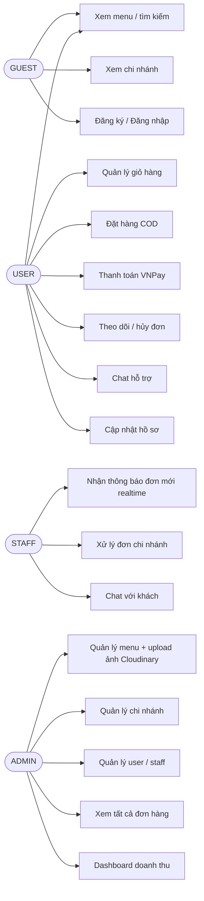
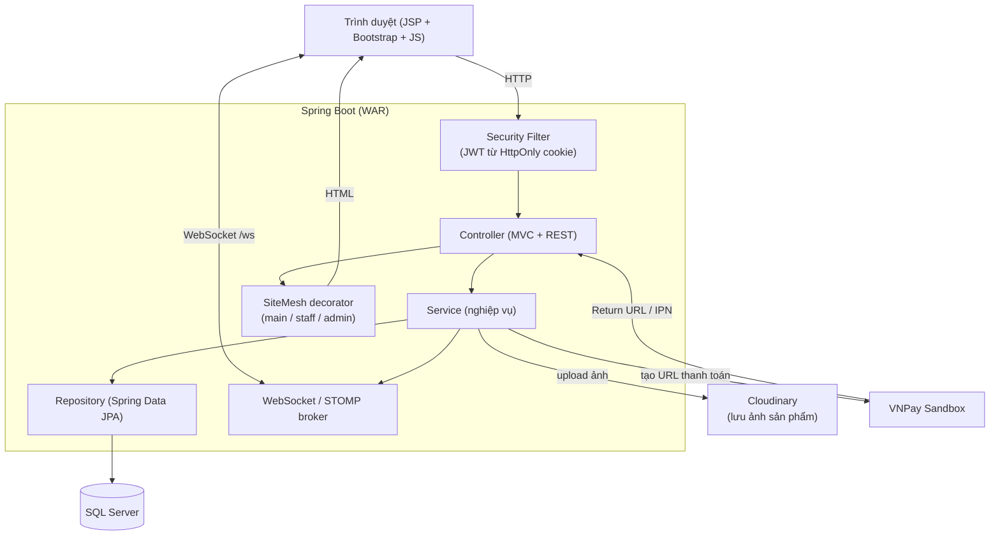
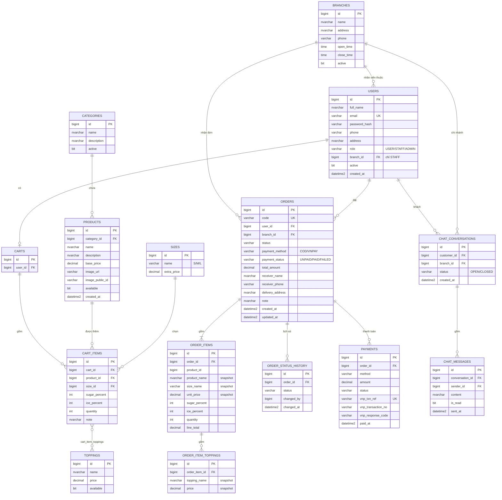
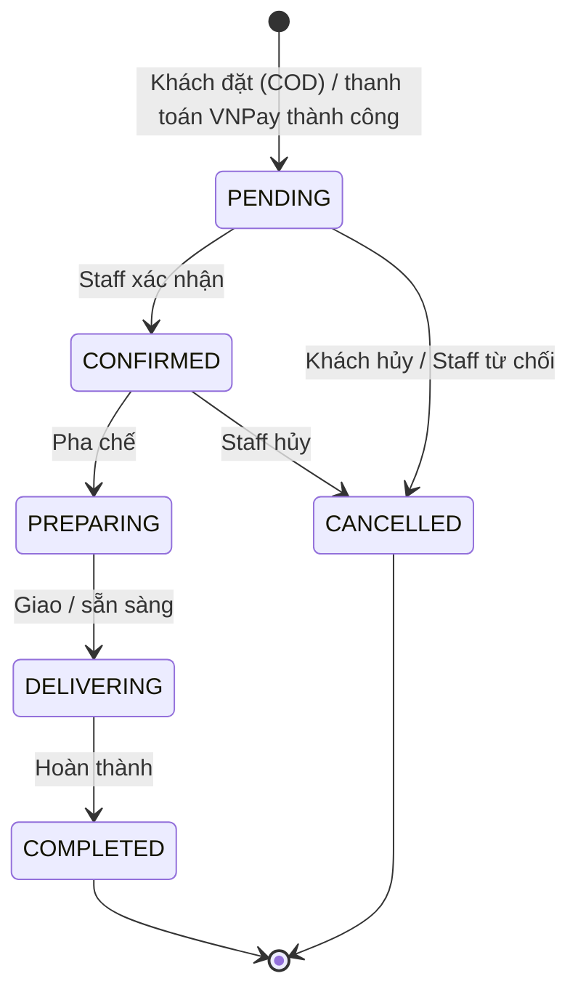
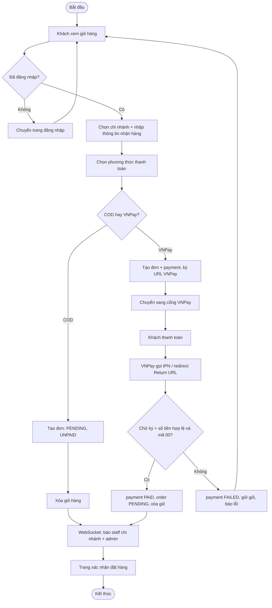
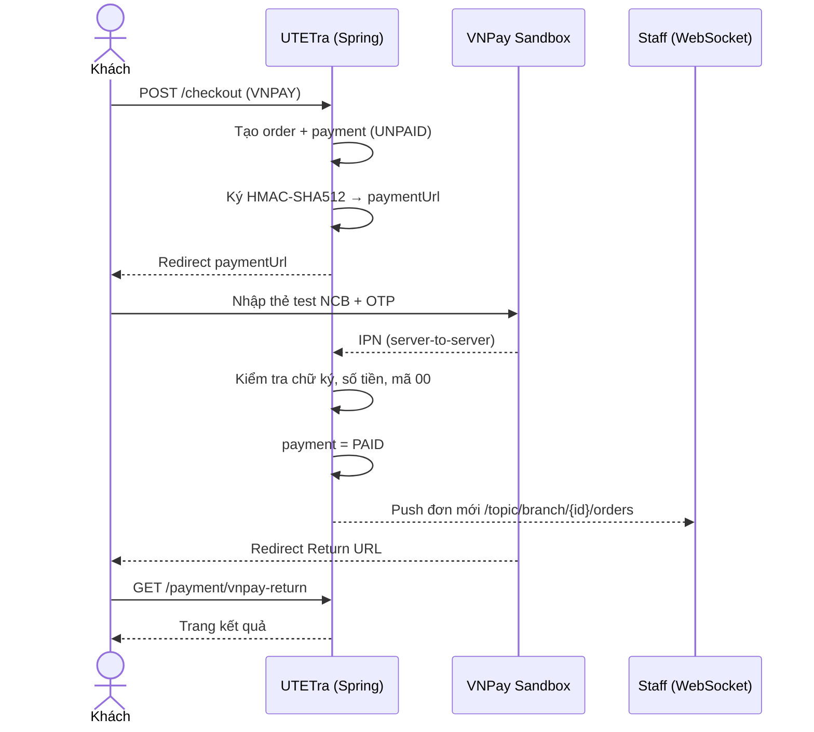
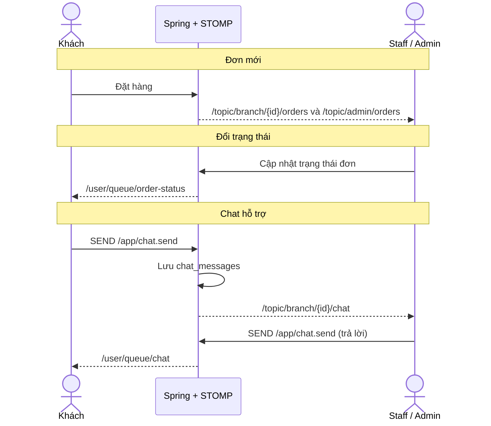

# UTETra - Phân tích & Thiết kế (Day 1)

Website chuỗi trà sữa UTETra. Công nghệ: Spring Boot 3 (WAR) + JSP/JSTL + SiteMesh 3 + Bootstrap 5 + JPA + SQL Server + JWT (HttpOnly cookie) + WebSocket (STOMP) + Cloudinary + VNPay sandbox.

> Phạm vi thanh toán: **COD** và **VNPay (sandbox)**. Không làm MoMo.

## 1. Vai trò (Actor)

| Vai trò | Mô tả |
|---|---|
| GUEST | Chưa đăng nhập: xem menu, chi tiết sản phẩm, chi nhánh, đăng ký, đăng nhập |
| USER | Khách hàng: giỏ hàng, đặt hàng, thanh toán, theo dõi đơn, chat hỗ trợ |
| STAFF | Nhân viên của **1 chi nhánh**: xử lý đơn của chi nhánh mình, chat với khách |
| ADMIN | Quản trị toàn hệ thống: menu, chi nhánh, tài khoản, mọi đơn hàng, doanh thu |

### Ma trận phân quyền

| Chức năng | GUEST | USER | STAFF | ADMIN |
|---|:-:|:-:|:-:|:-:|
| Xem menu / chi tiết / chi nhánh | ✔ | ✔ | ✔ | ✔ |
| Đăng ký / đăng nhập | ✔ | | | |
| Hồ sơ cá nhân | | ✔ | ✔ | ✔ |
| Giỏ hàng, đặt hàng, thanh toán | | ✔ | | |
| Xem / hủy đơn của mình | | ✔ | | |
| Chat hỗ trợ (phía khách) | | ✔ | | |
| Xem và đổi trạng thái đơn **chi nhánh mình** | | | ✔ | |
| Chat hỗ trợ (phía nhân viên) | | | ✔ | ✔ |
| Xem đơn **mọi chi nhánh** | | | | ✔ |
| CRUD danh mục / sản phẩm / topping (+ upload Cloudinary) | | | | ✔ |
| CRUD chi nhánh, quản lý user/staff (gán chi nhánh) | | | | ✔ |
| Dashboard doanh thu | | | | ✔ |

## 2. Use case (sơ đồ)



## 3. Kiến trúc hệ thống



Giải thích ngắn (để trả lời khi bị hỏi):
- **Mô hình 3 lớp**: Controller nhận request, Service chứa nghiệp vụ, Repository làm việc với DB.
- **SiteMesh** bọc mỗi trang JSP vào layout chung: giao diện khách (`main`), nhân viên (`staff`), quản trị (`admin`), nên không lặp header/footer.
- **JWT trong HttpOnly cookie**: JS không đọc được token nên khó bị XSS đánh cắp; hợp với web render server (JSP).
- **WebSocket/STOMP**: server chủ động đẩy dữ liệu (đơn mới, đổi trạng thái, tin nhắn) mà client không cần F5.
- **Cloudinary**: ảnh nằm trên cloud, DB chỉ lưu URL và `public_id` (để xóa/ghi đè ảnh).

## 4. Sơ đồ ERD (SQL Server)



Quyết định thiết kế quan trọng:
1. **Role là cột `role` trong `users`** (không tách bảng): đủ cho 3 vai trò cố định, đơn giản hơn.
2. **`order_items` lưu snapshot** tên, giá, size, topping: sau này đổi giá hoặc xóa món thì đơn cũ không bị sai.
3. **`users.branch_id`** chỉ có giá trị với STAFF, dùng để lọc đơn theo chi nhánh.
4. **`payments` tách khỏi `orders`**: một đơn có thể thử thanh toán VNPay nhiều lần. `vnp_txn_ref` là mã tham chiếu gửi sang VNPay (duy nhất mỗi lần).
5. **`order_status_history`** phục vụ việc khách theo dõi tiến trình.

## 5. Luồng trạng thái đơn hàng



Quy tắc:
- Khách chỉ được hủy khi đơn còn `PENDING`.
- COD: `payment_status = UNPAID`, chuyển `PAID` khi `COMPLETED`.
- VNPay: đơn tạo với `payment_status = UNPAID`; **chỉ thông báo cho staff khi VNPay xác nhận thành công** (IPN/return hợp lệ) để tránh đơn chưa trả tiền.

## 6. Activity diagram: Đặt hàng (checkout)



## 7. Sequence: Thanh toán VNPay



## 8. Sequence: Realtime + Chat



Kênh WebSocket (endpoint `/ws`, SockJS):

| Kênh | Ai nhận | Nội dung |
|---|---|---|
| `/topic/admin/orders` | ADMIN | đơn mới mọi chi nhánh |
| `/topic/branch/{id}/orders` | STAFF chi nhánh `id` | đơn mới của chi nhánh |
| `/user/queue/order-status` | khách của đơn | đổi trạng thái đơn |
| `/topic/branch/{id}/chat` | STAFF chi nhánh `id` | tin nhắn từ khách |
| `/user/queue/chat` | khách / staff trong hội thoại | tin nhắn trả lời |

## 9. Cấu trúc package và thư mục (sẽ dựng ở Day 2)

```
UTETra/
├── pom.xml
├── application-local.properties.example   (mẫu cấu hình bí mật; file thật application-local.properties bị .gitignore)
├── database/schema.sql, data.sql
├── docs/                         (tài liệu, sơ đồ, prompts.md)
└── src/main/
    ├── java/com/utetra/
    │   ├── UtetraApplication.java
    │   ├── config/               (SecurityConfig, WebSocketConfig, CloudinaryConfig, SiteMesh)
    │   ├── security/             (JwtService, JwtAuthFilter, UserDetails)
    │   ├── entity/               (User, Branch, Category, Product, ...)
    │   ├── repository/
    │   ├── service/
    │   ├── dto/
    │   ├── controller/
    │   │   ├── web/              (home, menu, cart, checkout, order, auth, profile)
    │   │   ├── staff/            (đơn chi nhánh, chat)
    │   │   └── admin/            (menu, chi nhánh, user, dashboard)
    │   ├── payment/              (VnPayService, VnPayController)
    │   ├── websocket/            (OrderNotifier, ChatController)
    │   └── exception/
    ├── resources/
    │   ├── application.properties
    │   └── static/ (css, js, images)
    └── webapp/WEB-INF/
        ├── decorators/           (main.jsp, staff.jsp, admin.jsp)
        └── views/                (common, auth, user, staff, admin)
```

## 10. Danh sách chức năng và ngày thực hiện

| Ngày | Chức năng |
|---|---|
| 2 | Dựng khung, kết nối SQL Server, entity, `schema.sql`/`data.sql` |
| 3 | Đăng ký, đăng nhập, JWT cookie, phân quyền, trang 403 |
| 4 | Trang chủ, menu theo danh mục, tìm kiếm, phân trang, chi tiết, chi nhánh |
| 5 | Admin CRUD danh mục/sản phẩm/topping, upload Cloudinary |
| 6 | Giỏ hàng (size/topping/đường/đá), checkout COD |
| 7 | Quản lý đơn: lịch sử, chi tiết, hủy; staff/admin xử lý đơn, luồng trạng thái |
| 8 | Thanh toán VNPay sandbox (URL, return, IPN, kiểm tra chữ ký) |
| 9 | WebSocket: đơn mới, đổi trạng thái, chat khách ↔ staff |
| 10 | Admin: chi nhánh, user/staff, dashboard doanh thu, hồ sơ |
| 11 | Dự phòng (nửa đầu) + kiểm thử |
| 12 | Sửa lỗi, responsive, xuất `.sql` cuối |
| 13 | Gộp tài liệu `.docx` |
| 14 | Slide, kiểm tra cuối, nộp bài |

## 11. Chia việc 2 người (đề xuất)

| Người A (backend) | Người B (giao diện + tài liệu) |
|---|---|
| Entity, service, security, payment, WebSocket, DB, GitHub | Kiểm tra giao diện JSP, chụp ảnh màn hình, ghi test case, viết `.docx`, slide |

## 12. Thông tin cấu hình cần chuẩn bị (không commit vào Git)

- SQL Server: host, port 1433, tên DB `utetra`, user/password
- Cloudinary: `cloud_name`, `api_key`, `api_secret`
- VNPay: `vnp_TmnCode`, `vnp_HashSecret`
- JWT secret (tự sinh, chuỗi dài ≥ 32 ký tự)
