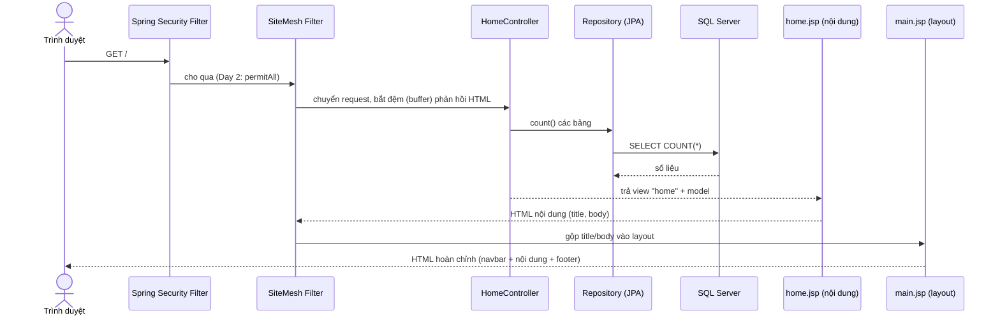

# Day 2 - Dựng khung dự án

## Luồng xử lý một request (vì sao layout tự được áp dụng)

## Chọn layout theo đường dẫn (`SiteMeshConfig`)

| Đường dẫn | Layout |
|---|---|
| `/admin/*` | `WEB-INF/decorators/admin.jsp` |
| `/staff/*` | `WEB-INF/decorators/staff.jsp` |
| còn lại | `WEB-INF/decorators/main.jsp` |

Trang con (ví dụ `home.jsp`) chỉ chứa `<title>` và nội dung `<body>`. SiteMesh chèn chúng vào `<sitemesh:write property='title'/>` và `<sitemesh:write property='body'/>` của layout.

## Những điểm hay bị hỏi

- **Vì sao đóng gói WAR?** Spring Boot JAR không hỗ trợ JSP tốt; WAR chạy được cả bằng `java -jar` lẫn trên Tomcat ngoài (nhờ `SpringBootServletInitializer`).
- **`ddl-auto=validate`:** Hibernate chỉ kiểm tra entity khớp bảng do `schema.sql` tạo, không tự sửa DB. Lệch thì ứng dụng báo lỗi ngay lúc khởi động.
- **`use_nationalized_character_data=true`:** chuỗi Java ánh xạ sang `NVARCHAR`, lưu được tiếng Việt có dấu.
- **Bí mật nằm ngoài Git:** `application-local.properties` (đã `.gitignore`) chứa mật khẩu DB; `application.properties` chỉ có placeholder `${DB_PASSWORD:}`.
- **Bootstrap qua WebJar:** file CSS/JS nằm trong thư viện Maven nên chạy được khi không có Internet.
