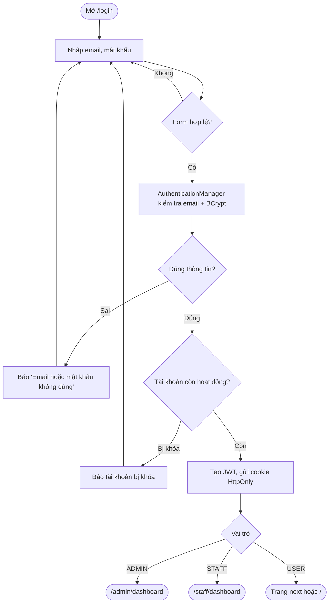
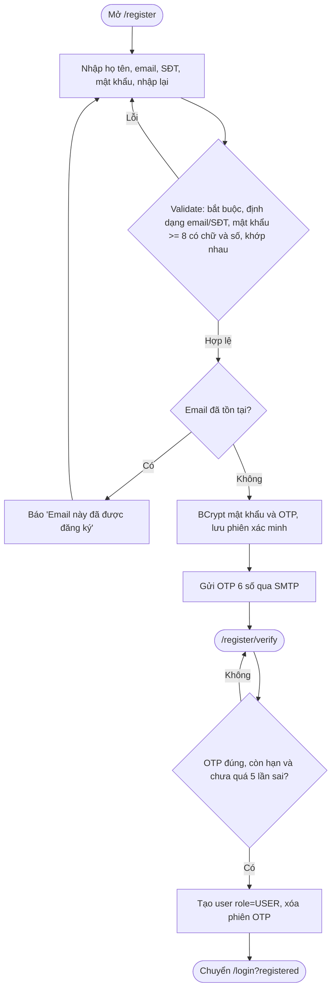
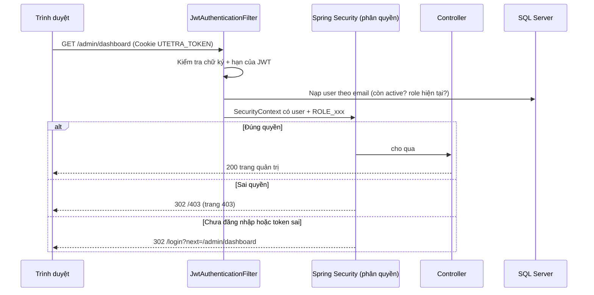

# Day 3 - Đăng ký, đăng nhập, JWT, phân quyền

## 1. Tổng quan

- Đăng ký tại `/register`, nhận OTP 6 số qua email và chỉ tạo tài khoản USER sau khi xác minh tại `/register/verify`.
- Quên mật khẩu tại `/forgot-password`: gửi OTP tới email khách hàng, xác minh rồi đặt mật khẩu mới theo cùng chính sách lúc đăng ký.
- Sau khi đăng nhập, server tạo **JWT** và gửi trong cookie `UTETRA_TOKEN` (**HttpOnly**, SameSite=Lax) nên JavaScript không đọc được token.
- Mỗi request, `JwtAuthenticationFilter` đọc cookie, kiểm tra chữ ký và hạn, nạp lại user từ DB rồi đặt vào `SecurityContext`.
- Không dùng HttpSession cho đăng nhập (`STATELESS`).
- Mật khẩu và OTP đều lưu dạng **BCrypt**, không lưu bản rõ. OTP hết hạn sau 10 phút, tối đa 5 lần nhập sai và chỉ được gửi lại sau 60 giây.
- Form có **CSRF token** (cookie `XSRF-TOKEN` + trường ẩn `_csrf`).

## 2. Phân quyền

| Đường dẫn | Ai được vào | Sai quyền |
|---|---|---|
| `/`, `/login`, `/register`, `/register/**`, `/forgot-password/**`, `/health`, `/403`, `/css/**`, `/js/**`, `/images/**`, `/webjars/**` | Tất cả | - |
| `/admin/**` | ADMIN | chưa đăng nhập: về `/login?next=...`; sai vai trò: trang 403 |
| `/staff/**` | STAFF, ADMIN | như trên |
| `/cart/**`, `/checkout/**`, `/orders/**` | USER | như trên |
| Đường dẫn còn lại | Phải đăng nhập | về `/login` |

Sau đăng nhập: ADMIN vào `/admin/dashboard`, STAFF vào `/staff/dashboard`, USER về `/` (hoặc đường dẫn `next` hợp lệ).

## 3. Sơ đồ hoạt động: đăng nhập

## 4. Sơ đồ hoạt động: đăng ký

## 5. Sơ đồ tuần tự: một request có JWT

## 6. Cách chạy và kiểm tra

1. Thêm `JWT_SECRET=<chuỗi ngẫu nhiên >= 32 ký tự>` và cấu hình `MAIL_HOST`, `MAIL_PORT`, `MAIL_USERNAME`, `MAIL_PASSWORD` vào `application-local.properties`.
2. Dừng bản đang chạy (Ctrl+C) rồi chạy lại `.\mvnw.cmd spring-boot:run`.
3. Kiểm tra bằng trình duyệt (nên dùng cửa sổ ẩn danh để không dính cookie cũ):

| Bước | Thao tác | Kết quả đúng |
|---|---|---|
| 1 | Vào `/admin/dashboard` khi chưa đăng nhập | Chuyển về `/login?next=%2Fadmin%2Fdashboard` |
| 2 | Đăng nhập `user1@utetra.vn` / `Utetra@123` | Về trang chủ, navbar hiện tên người dùng và nút Đăng xuất |
| 3 | Vào `/admin/dashboard` hoặc `/staff/dashboard` | Trang 403 |
| 4 | Đăng xuất, đăng nhập `staff1@utetra.vn` | Vào `/staff/dashboard`; vào `/admin/dashboard` thì 403 |
| 5 | Đăng xuất, đăng nhập `admin@utetra.vn` | Vào `/admin/dashboard`; vào `/staff/dashboard` cũng được |
| 6 | Đăng nhập sai mật khẩu | Báo "Email hoặc mật khẩu không đúng" (sai email cũng báo y hệt) |
| 7 | Đăng ký email mới, mật khẩu `Passw0rd1` | Chuyển sang trang nhập OTP; chưa có user trong bảng `users` |
| 8 | Nhập OTP đúng trong email | Tạo USER, chuyển `/login`, báo thành công và đăng nhập được |
| 9 | Nhập OTP sai | Báo số lần còn lại; quá 5 lần phải gửi mã mới |
| 10 | Chọn “Quên mật khẩu”, nhập email USER và OTP đúng | Đổi được mật khẩu, OTP bị xóa và đăng nhập được bằng mật khẩu mới |
| 10 | Nhấn gửi lại trước/sau 60 giây | Trước 60 giây bị từ chối; sau đó gửi mã mới và mã cũ mất hiệu lực |
| 11 | Đăng ký lại email `user1@utetra.vn` | Báo "Email này đã được đăng ký" |
| 12 | F12 > Application > Cookies | `UTETRA_TOKEN` có dấu HttpOnly |

Unit test: `.\mvnw.cmd "-Dtest=JwtServiceTest" test` (5 test: token hợp lệ, bị sửa, sai khóa, hết hạn, secret quá ngắn).

## 7. Các câu hỏi có thể bị hỏi khi bảo vệ

- **JWT là gì, vì sao cookie HttpOnly?** JWT là chuỗi `header.payload.signature`, server ký bằng khóa bí mật nên không thể sửa mà không bị phát hiện. Để trong cookie HttpOnly thì script XSS không đọc trộm được.
- **Vì sao lại nạp user từ DB mỗi request nếu đã có JWT?** Để khi admin khóa tài khoản hoặc đổi vai trò thì có hiệu lực ngay, không phải chờ token hết hạn. Đổi lại tốn 1 truy vấn nhẹ mỗi request.
- **Cookie thì có bị CSRF không?** Có nguy cơ, nên mọi `POST` đều yêu cầu CSRF token; cookie còn có `SameSite=Lax`.
- **Vì sao báo lỗi chung cho sai email và sai mật khẩu?** Để kẻ xấu không dò được email nào có trong hệ thống.
- **`next` có nguy hiểm không?** Có thể bị lợi dụng chuyển hướng sang trang khác (open redirect), nên chỉ chấp nhận đường dẫn nội bộ bắt đầu bằng `/` (không phải `//`).
- **Vì sao phải `permit` FORWARD?** Spring Security 6 kiểm tra cả việc controller chuyển tiếp nội bộ tới file JSP; nếu không cho qua thì mọi trang bị chặn.
- **Vì sao tắt `sessionManagement`?** Khi bật, Spring coi mỗi request có JWT là "vừa đăng nhập" nên đổi CSRF token ở mọi request (kể cả tải CSS); token trong form Đăng xuất thành cũ → bị 403. Tắt đi (kèm `NullRequestCache`, `RequestAttributeSecurityContextRepository`) thì token ổn định và không tạo `JSESSIONID`.
- **Vì sao không lưu OTP trực tiếp?** Nếu database bị đọc trộm, mã còn hiệu lực cũng không lộ. Server dùng BCrypt để so sánh mã người dùng nhập.
- **Vì sao chưa tạo user ngay khi gửi OTP?** Để email chưa được kiểm soát không thể trở thành tài khoản hợp lệ; dữ liệu tạm nằm ở `registration_otps` và bị xóa khi xác minh thành công.
