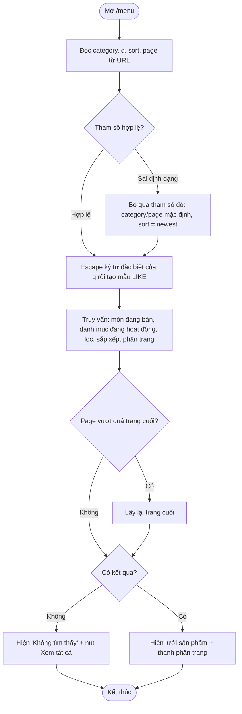
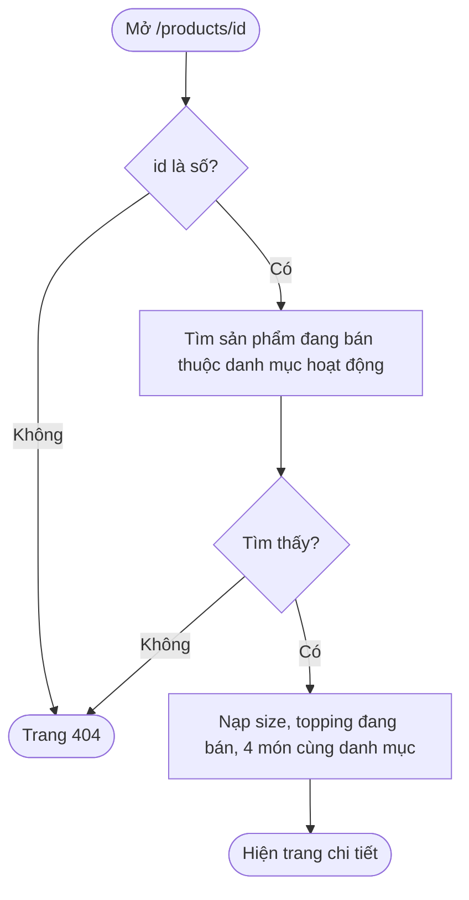

# Day 4 - Trang khách: thực đơn, tìm kiếm, chi tiết, chi nhánh

## 1. Chức năng

| URL | Chức năng |
|---|---|
| `/` | Trang chủ: ô tìm kiếm, danh mục, 8 đồ uống mới nhất, chi nhánh |
| `/menu` | Thực đơn: lọc danh mục (`category`), tìm theo tên (`q`), sắp xếp (`sort`), phân trang (`page`, 8 món/trang) |
| `/products/{id}` | Chi tiết: ảnh, mô tả, giá gốc, size, topping, đồ uống cùng loại |
| `/branches` | Chi nhánh đang hoạt động, giờ mở cửa, nhãn Đang mở/Đã đóng, link Google Maps |
| 404 | Trang "Không tìm thấy" (sản phẩm không tồn tại, ngừng bán, hoặc danh mục bị ẩn) |

Các trang này mở tự do (không cần đăng nhập), chỉ cho phương thức GET. Nút "Thêm vào giỏ hàng" đang bị khóa, sẽ làm ở Day 6.

## 2. Sơ đồ hoạt động: xem thực đơn

## 3. Sơ đồ hoạt động: xem chi tiết sản phẩm

## 4. Phân công (Day 4)

| Người | Phần việc | File chính |
|---|---|---|
| LamNhatAn | Backend: truy vấn, service, controller, bảo mật, test | `ProductRepository`, `CatalogService`, `MenuController`, `ProductController`, `BranchController`, `HomeController`, `SecurityConfig`, `SiteMeshConfig`, `LocaleConfig`, `CatalogServiceTest` |
| Nguyễn Tiến Đạt | Giao diện JSP, CSS, navbar | `home.jsp`, `menu.jsp`, `product-detail.jsp`, `branches.jsp`, `error/404.jsp`, `fragments/product-card.jspf`, `decorators/main.jsp`, `app.css` |

Dữ liệu controller truyền cho JSP:

| Trang | Thuộc tính model |
|---|---|
| home | `featured` (List Product), `categories`, `branches` (List BranchInfo) |
| menu | `products` (Page Product: `content`, `number` tính từ 0, `totalPages`, `totalElements`), `categories`, `selectedCategoryId`, `q`, `sort` |
| product-detail | `product`, `sizes`, `toppings`, `related` |
| branches | `branches` (List BranchInfo: `branch`, `openNow`) |

## 5. Kiểm tra từng bước

1. Dừng app cũ (Ctrl+C), chạy lại `mvnw.cmd spring-boot:run`.
2. Mở `/menu`: thấy 8 món, có thanh phân trang 1, 2. Bấm trang 2: thấy 4 món.
3. Bấm danh mục "Cà phê": còn 3 món. Danh mục đang chọn đổi màu.
4. Gõ `tra sua` vào ô tìm: ra 4 món trà sữa (không cần gõ dấu). Gõ `zzz`: hiện "Không tìm thấy".
5. Chọn sắp xếp "Giá tăng dần": món rẻ nhất (Cà phê sữa đá 29.000 đ) đứng đầu.
6. Bấm một món: thấy giá `35.000 đ`, 3 size (M +5.000 đ), 6 topping, các món cùng loại.
7. Mở `/products/999`: trang 404 có thanh menu.
8. Mở `/branches`: 3 chi nhánh. Nhãn Đang mở/Đã đóng phụ thuộc giờ hiện tại.
9. Chưa đăng nhập mà mở `/cart`: bị chuyển về `/login` (đường dẫn của USER vẫn được bảo vệ).

Chạy test: `mvnw.cmd test` (11 test: 5 JwtService + 6 CatalogService).

## 6. Giải thích để trả lời khi bị hỏi

- **Vì sao tìm "tra sua" ra "Trà sữa"?** Truy vấn so sánh theo collation `Latin1_General_100_CI_AI` (không phân biệt hoa thường và dấu). Collation `Vietnamese_*` của cơ sở dữ liệu coi các chữ như ư, ê là chữ riêng nên không dùng được cho mục đích này.
- **Vì sao phải escape `%`, `_`, `[` trong từ khóa?** Đây là ký tự đại diện của LIKE trong SQL Server. Nếu không escape, người dùng gõ `%` sẽ ra toàn bộ sản phẩm. Truy vấn dùng tham số (không nối chuỗi) nên không bị SQL injection.
- **Vì sao `sort` chỉ nhận vài giá trị?** `normalizeSort` dùng danh sách cho phép. Giá trị lạ được đổi thành `newest`, tránh để người dùng chọn cột bất kỳ.
- **Vì sao dùng `join fetch`?** Nạp luôn danh mục của sản phẩm trong một câu SQL, tránh lỗi N+1 (mỗi thẻ sản phẩm lại truy vấn thêm một lần).
- **Vì sao tham số sai không báo lỗi 400?** Người dùng có thể sửa URL tay; trang vẫn hiển thị với giá trị mặc định thay vì báo lỗi.
- **Vì sao dùng `FixedLocaleResolver`?** Để JSTL định dạng số theo kiểu Việt Nam (35.000) bất kể ngôn ngữ trình duyệt.
- **`c:out` để làm gì?** Mã hóa HTML dữ liệu người dùng (từ khóa, tên sản phẩm) để chống XSS.
