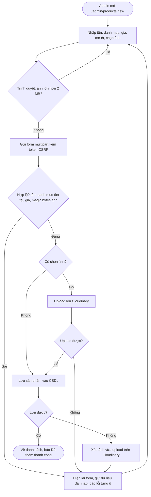
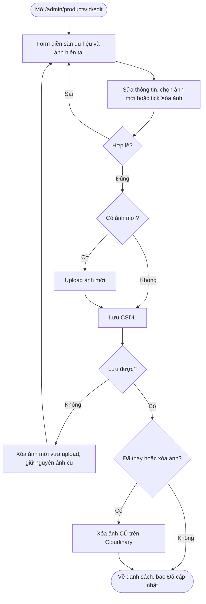
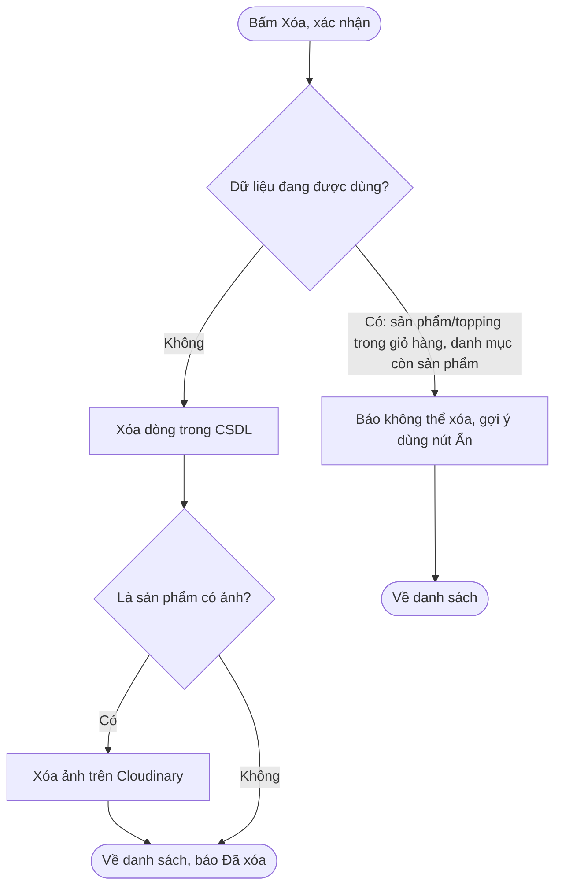

# Day 5 - Admin: sản phẩm, danh mục, topping và upload ảnh Cloudinary

## 1. Chức năng

Chỉ tài khoản **ADMIN** vào được (`/admin/**` đã được `SecurityConfig` chặn; USER/STAFF bị chuyển tới trang 403, người chưa đăng nhập về `/login`).

| URL | Chức năng |
|---|---|
| `/admin/products` | Danh sách sản phẩm (tìm theo tên không dấu, lọc danh mục, 10 dòng/trang), Sửa, Ẩn/Hiện, Xóa |
| `/admin/products/new`, `/admin/products/{id}/edit` | Form thêm/sửa sản phẩm, có upload ảnh lên Cloudinary |
| `/admin/categories` | Danh sách danh mục kèm số sản phẩm, Sửa, Ẩn/Hiện, Xóa |
| `/admin/toppings` | Danh sách topping, Sửa, Ẩn/Hiện, Xóa |

Quy tắc dữ liệu:

| Đối tượng | Hợp lệ | Xóa được khi |
|---|---|---|
| Sản phẩm | tên bắt buộc ≤ 150 ký tự, danh mục bắt buộc, giá nguyên ≥ 1.000 đ, mô tả ≤ 1000 ký tự | không nằm trong giỏ hàng nào |
| Danh mục | tên bắt buộc ≤ 100 ký tự, **không trùng tên** | chưa có sản phẩm nào |
| Topping | tên bắt buộc ≤ 100 ký tự, **không trùng tên**, giá nguyên ≥ 0 | không nằm trong giỏ hàng nào |

Tên danh mục và topping được kiểm tra ở cả ứng dụng lẫn `UNIQUE constraint` trong SQL Server để vẫn chặn được hai request tạo trùng tên cùng lúc. Với database đã tạo trước bản sửa này, chạy một lần:

```powershell
sqlcmd -S localhost -E -C -f 65001 -i database\nhom9_Database.sql
```

Script không xóa dữ liệu. Nếu dữ liệu hiện tại đã có tên trùng, script sẽ dừng và yêu cầu xử lý bản ghi trùng trước.

- Không xóa được thì hiện thông báo và gợi ý dùng nút **Ẩn**. Ẩn danh mục sẽ ẩn luôn sản phẩm của nó trên trang khách.
- Đơn hàng đã đặt lưu **bản sao** tên và giá (không khóa ngoại), nên xóa sản phẩm hay topping không làm hỏng đơn cũ.
- Sau mỗi thao tác, trang quay lại danh sách kèm `?ok=...` hoặc `?err=...`; `AdminNoticeAdvice` đổi mã đó thành câu cố định (không in thẳng tham số URL nên không chèn nội dung giả vào trang, và không cần session).

## 2. Cloudinary

- Cấu hình trong `application-local.properties` (xem README mục 4): `cloudinary.cloud-name`, `cloudinary.api-key`, `cloudinary.api-secret`. Không có trong Git.
- Chưa cấu hình: web vẫn chạy, form sản phẩm báo "Chưa cấu hình Cloudinary", ô chọn ảnh bị khóa, vẫn lưu được sản phẩm không có ảnh.
- Ảnh lưu ở thư mục `utetra/products` trên Cloudinary, thu nhỏ tối đa 1200x1200. Trong CSDL lưu `image_url` (để hiển thị) và `image_public_id` (để xóa/thay).
- Danh sách admin dùng ảnh thu nhỏ 80x80 bằng cách chèn phép biến đổi `c_fill,w_80,h_80` vào URL Cloudinary nên không tải ảnh gốc.

### Kiểm tra ảnh trước khi upload (`ImageStorageService.validate`)
1. Có file và không rỗng.
2. Tối đa **2 MB**.
3. Đọc **12 byte đầu** (magic bytes) để xác nhận JPG, PNG hoặc WEBP. Không tin tên file hay `Content-Type` do trình duyệt gửi, nên file `.png` thực chất là mã HTML bị từ chối.

## 3. Sơ đồ hoạt động: thêm sản phẩm có ảnh



## 4. Sơ đồ hoạt động: sửa sản phẩm đổi ảnh



## 5. Sơ đồ hoạt động: xóa



## 6. Phân công (Day 5)

| Người | Phần việc | File chính |
|---|---|---|
| LamNhatAn | Cloudinary + quản lý sản phẩm | `ImageStorageService`, `AdminProductService`, `AdminProductController`, `ProductForm`, `AdminNoticeAdvice`, `views/admin/products/*`, `views/admin/_notice.jspf`, các test của ảnh và sản phẩm |
| Nguyễn Tiến Đạt | Quản lý danh mục và topping, menu admin, tài liệu | `AdminCategoryService/Controller`, `AdminToppingService/Controller`, `CategoryForm`, `ToppingForm`, `views/admin/categories/*`, `views/admin/toppings/*`, `admin.jsp`, `messages.properties`, `docs/05-admin-catalog.md` |

## 7. Kiểm tra từng bước (đăng nhập `admin@utetra.vn` / `Utetra@123`)

1. Dừng app cũ rồi chạy lại `mvnw.cmd spring-boot:run`. Thanh bên trái có Sản phẩm, Danh mục, Topping.
2. `/admin/products`: 12 sản phẩm, 2 trang. Gõ `tra sua` vào ô tìm: ra 4 món.
3. **Danh mục:** thêm danh mục "Bánh ngọt" (thành công); thêm lại "bánh ngọt" (báo trùng tên); thử xóa "Trà sữa" (báo không xóa được vì còn sản phẩm); xóa "Bánh ngọt" (thành công).
4. **Topping:** thêm "Hạt chia" giá 6000; nhập giá chữ `abc` (báo "Vui lòng nhập một số hợp lệ"); bấm Ẩn rồi mở `/products/1` thấy topping không còn; bấm Hiện thì thấy lại; xóa.
5. **Sản phẩm không ảnh:** thêm "Trà thử" (danh mục Trà trái cây, giá 30000); để tên trống rồi lưu thì báo lỗi và giữ dữ liệu; sửa giá; bấm Ẩn thì mất khỏi `/menu`; xóa.
6. **Ảnh (cần khóa Cloudinary):** thêm sản phẩm kèm ảnh JPG dưới 2 MB: thấy ảnh nhỏ trong danh sách, ảnh lớn ở `/menu` và `/products/{id}`; vào Cloudinary Console → Media Library thấy ảnh trong thư mục `utetra/products`. Sửa và chọn ảnh khác: ảnh cũ biến mất khỏi Cloudinary. Xóa sản phẩm: ảnh biến mất.
7. **Ảnh sai:** chọn file `.txt` đổi tên thành `.png` thì báo "Chỉ chấp nhận ảnh JPG, PNG hoặc WEBP"; chọn ảnh lớn hơn 2 MB thì trình duyệt báo ngay.
8. Đăng nhập `user1@utetra.vn` rồi mở `/admin/products`: bị chuyển tới trang 403.

Chạy test: `mvnw.cmd test` (38 test; Day 5 thêm 27 test: 6 kiểm tra ảnh, 11 sản phẩm, 10 danh mục và topping).

## 8. Giải thích để trả lời khi bị hỏi

- **Vì sao dùng Cloudinary thay vì lưu ảnh vào thư mục máy chủ?** Ảnh nằm ngoài ứng dụng nên deploy lại không mất ảnh, có CDN và tự thu nhỏ/biến đổi bằng tham số trên URL. CSDL chỉ lưu URL và `public_id`.
- **`public_id` để làm gì?** Là định danh ảnh trên Cloudinary, dùng để xóa hoặc thay ảnh khi sửa/xóa sản phẩm.
- **Vì sao đọc magic bytes?** Tên file và Content-Type do client gửi nên có thể bị giả; 12 byte đầu mới cho biết file thật sự là ảnh gì, tránh upload mã độc đội lốt ảnh.
- **Vì sao service sản phẩm không dùng `@Transactional`?** Việc gọi Cloudinary không rollback được. Nên thủ công: upload xong mà lưu CSDL lỗi thì xóa ảnh vừa upload; chỉ xóa ảnh cũ sau khi lưu CSDL thành công. Nhờ vậy không có ảnh "mồ côi" tốn dung lượng hay sản phẩm trỏ tới ảnh đã mất.
- **Vì sao kiểm tra "đang trong giỏ hàng" trước khi xóa?** `cart_items` có khóa ngoại tới sản phẩm; kiểm tra trước để báo lời dễ hiểu. Phần bắt `DataIntegrityViolationException` là lưới an toàn khi có xung đột cùng lúc.
- **Vì sao form có file đặt token CSRF trên URL?** Khi ảnh vượt giới hạn server (5 MB), Tomcat bỏ dở việc đọc body nên mất trường ẩn `_csrf` và người dùng thấy trang 403 khó hiểu. Token trên URL giúp bước CSRF vẫn qua, controller báo đúng "ảnh quá lớn".
- **Tại sao thông báo dùng `?ok=created` chứ không dùng flash?** Flash attribute cần HttpSession, mà ứng dụng cố ý không dùng session (JWT stateless).
- **Tên danh mục "Trà sữa" và "TRÀ SỮA" trùng nhau?** Có, vì cột dùng collation `Vietnamese_100_CI_AS` (không phân biệt hoa thường), còn dấu thì vẫn phân biệt.
