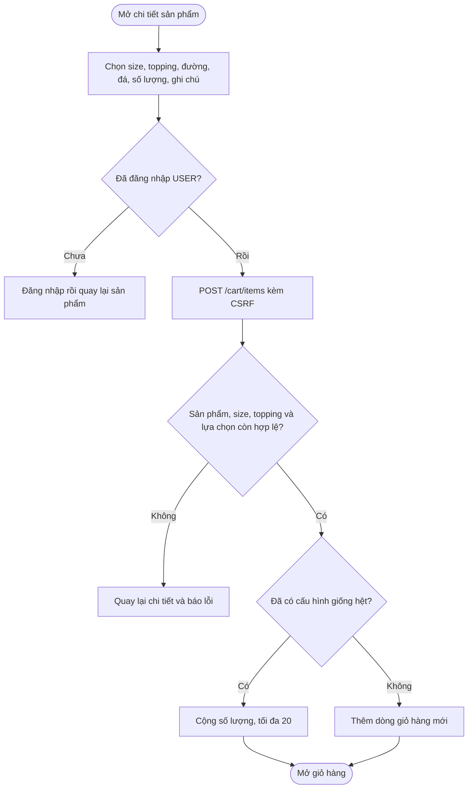
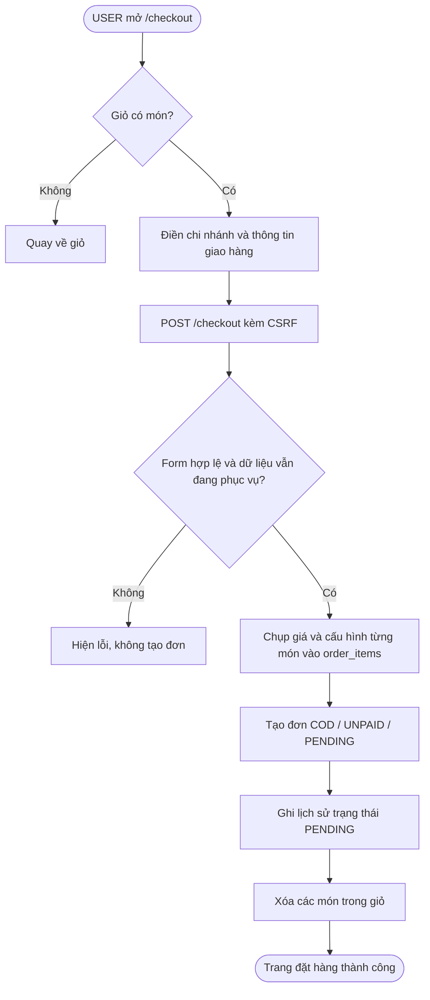

# Day 6 - Giỏ hàng và đặt hàng COD

## 1. Chức năng

Chỉ tài khoản **USER** sử dụng được giỏ hàng và thanh toán. Khách chưa đăng nhập được chuyển tới `/login`; STAFF/ADMIN nhận trang 403.

| URL | Chức năng |
|---|---|
| `/products/{id}` | Chọn size, topping, mức đường, mức đá, số lượng và ghi chú rồi thêm vào giỏ |
| `/cart` | Xem giỏ, tính tiền, đổi số lượng, xóa một món hoặc xóa toàn bộ |
| `/checkout` | Chọn chi nhánh, nhập người nhận và đặt đơn COD |
| `/checkout/success/{code}` | Xem kết quả của đơn vừa đặt; chỉ chủ đơn được xem |

Quy tắc chính:

- Đường và đá chỉ nhận `0, 30, 50, 70, 100`; mỗi cấu hình món có số lượng từ 1 đến 20.
- Hai món chỉ được gộp số lượng khi giống hoàn toàn sản phẩm, size, topping, đường, đá và ghi chú.
- Giá một ly = giá gốc + phụ thu size + tổng giá topping. Tổng dòng = giá một ly × số lượng.
- Trước khi tạo đơn, server kiểm tra lại tài khoản, chi nhánh, sản phẩm, danh mục và topping còn hoạt động.
- Đơn lưu bản sao tên món, size, topping, giá, đường, đá và ghi chú. Việc admin sửa menu sau đó không làm thay đổi đơn cũ.
- Day 6 chỉ thanh toán **COD**: đơn mới có trạng thái `PENDING`, thanh toán `UNPAID`.

Database đã tồn tại từ Day trước cần chạy một lần:

```powershell
sqlcmd -S localhost -E -C -f 65001 -i database\nhom9_Database.sql
```

Script thêm ghi chú món vào `order_items` và các `CHECK constraint`, không xóa dữ liệu.

## 2. Luồng thêm vào giỏ



## 3. Luồng đặt hàng COD



Toàn bộ bước tạo đơn, lịch sử và xóa giỏ nằm trong một transaction. Nếu một bước lỗi thì tất cả được rollback, tránh có đơn thiếu món hoặc mất giỏ hàng.

## 4. Bảo mật và kiểm tra dữ liệu

- Không nhận `userId` từ form; lấy ID từ JWT đang đăng nhập.
- Cập nhật/xóa dòng giỏ dùng truy vấn đồng thời theo `itemId` và `userId`, nên USER không sửa được giỏ của người khác.
- Trang thành công tìm đơn theo cả `code` và `userId`; mã đơn của người khác trả về 404.
- Tất cả request thay đổi dữ liệu là POST và có CSRF token.
- Giá được tính lại ở server từ database; không tin giá do trình duyệt gửi.
- Bean Validation kiểm tra tên, điện thoại, địa chỉ và độ dài ghi chú; service kiểm tra lại trạng thái dữ liệu tại thời điểm đặt.

## 5. Phân công (Day 6)

| Người | Phần việc | File chính |
|---|---|---|
| LamNhatAn | Nghiệp vụ giỏ hàng, tính giá, tạo đơn COD, snapshot và ràng buộc database | `CartService`, `CheckoutService`, DTO, repository, entity, controller, `database/nhom9_Database.sql`, test service |
| Nguyễn Tiến Đạt | Giao diện chọn món, giỏ hàng, checkout, trang thành công và tài liệu | `product-detail.jsp`, `cart.jsp`, `checkout.jsp`, `checkout-success.jsp`, `main.jsp`, `app.css`, `docs/06-cart-checkout.md`, README |

## 6. Kiểm tra từng bước (`user1@utetra.vn` / `Utetra@123`)

1. Dừng app, chạy script nâng cấp Day 6 ở trên, rồi chạy `mvnw.cmd spring-boot:run`.
2. Chưa đăng nhập, mở `/products/1`: thấy nút **Đăng nhập để đặt món**. Mở `/cart`: được chuyển tới login.
3. Đăng nhập USER, mở `/products/1`, chọn size M, topping Trân châu đen, đường 70%, đá 50%, số lượng 2, nhập ghi chú rồi bấm **Thêm vào giỏ hàng**.
4. Kiểm tra giỏ hiển thị đúng cấu hình và tiền: `(giá gốc + phụ thu size + topping) × 2`.
5. Thêm lại đúng cấu hình: dòng cũ được cộng số lượng. Đổi một lựa chọn hoặc ghi chú: tạo dòng mới.
6. Trong `/cart`, đổi số lượng, xóa một món, thêm lại rồi thử **Xóa toàn bộ**. Sau đó thêm ít nhất một món để checkout.
7. Mở `/checkout`: thông tin tài khoản được điền sẵn. Để trống tên hoặc nhập sai số điện thoại thì form báo lỗi và chưa tạo đơn.
8. Chọn chi nhánh, nhập địa chỉ, bấm **Xác nhận đặt hàng**: thấy mã đơn, các món, tổng tiền và COD; quay lại `/cart` thấy giỏ trống.
9. Sao chép URL thành công, đăng nhập `user2@utetra.vn` rồi mở URL đó: nhận trang 404.
10. Đăng nhập STAFF hoặc ADMIN và mở `/cart`: nhận trang 403.

Chạy tự động:

```powershell
mvnw.cmd clean test
```

Kết quả hiện tại: **50 test**, không lỗi (Day 6 thêm 12 test cho giỏ hàng và checkout).

## 7. Giải thích để trả lời khi bị hỏi

- **Vì sao không gửi giá từ form?** Người dùng có thể sửa HTML/request. Server luôn đọc giá hiện tại trong database và tự tính lại.
- **Vì sao đơn hàng phải lưu snapshot?** Menu và giá có thể thay đổi; đơn đã đặt phải giữ đúng tên, cấu hình và số tiền tại lúc mua.
- **Vì sao giỏ lưu từng cấu hình thành dòng riêng?** Cùng một sản phẩm nhưng khác size, topping, đường, đá hoặc ghi chú là hai món pha chế khác nhau.
- **Vì sao đặt hàng dùng transaction?** Tạo đơn, tạo lịch sử và xóa giỏ là một thao tác thống nhất; nếu lỗi giữa chừng, database quay lại trạng thái cũ.
- **Vì sao kiểm tra trạng thái sản phẩm hai lần?** Món có thể bị admin ẩn sau lúc khách thêm vào giỏ nhưng trước lúc checkout.
- **Vì sao mã đơn có phần ngẫu nhiên?** Phần thời gian giúp đọc và tra cứu, phần UUID rút gọn hạn chế trùng khi có nhiều đơn trong cùng một giây; cột database vẫn có UNIQUE constraint.

## 8. Chuẩn bị Day 7

Day 7 nên làm quản lý đơn phía khách hàng:

1. Trang `/orders` liệt kê đơn của USER, phân trang và sắp mới nhất trước.
2. Trang `/orders/{code}` hiển thị chi tiết và lịch sử trạng thái.
3. USER chỉ được hủy đơn khi còn `PENDING`; ghi lịch sử `CANCELLED` trong cùng transaction.
4. Thêm trạng thái hiển thị tiếng Việt, badge màu và kiểm tra quyền sở hữu đơn.
5. Viết test cho xem danh sách, xem chi tiết, hủy hợp lệ, hủy sai trạng thái và truy cập đơn người khác.
