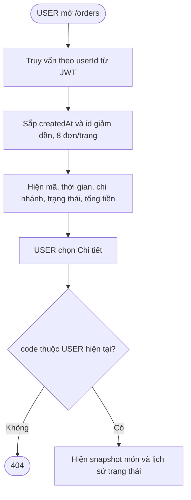
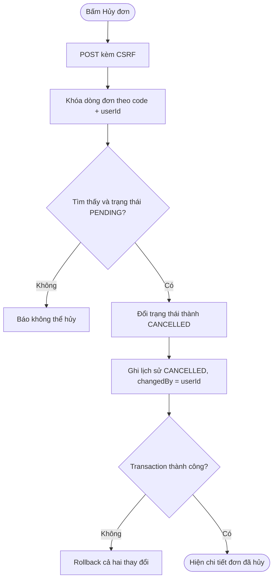
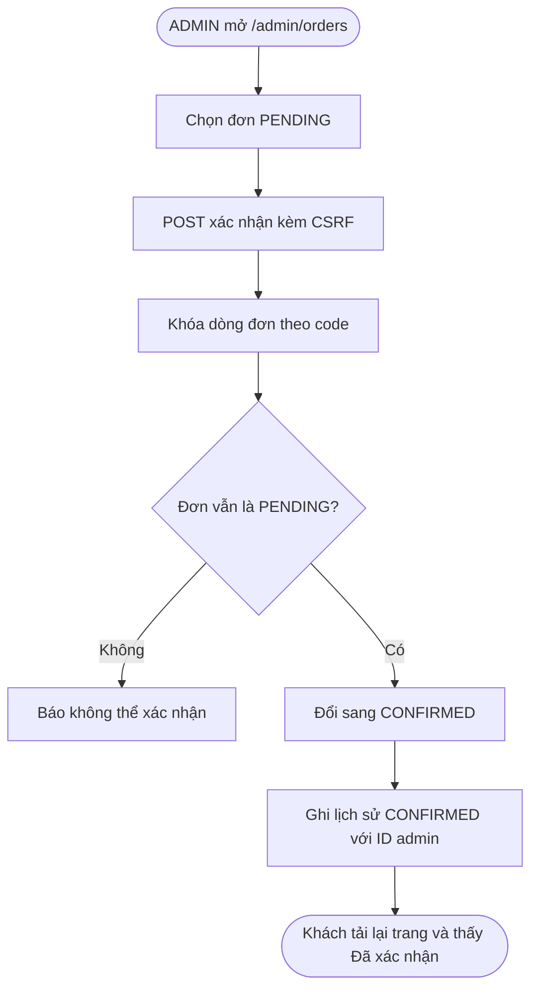

# Day 7 - Theo dõi và xác nhận đơn hàng

## 1. Chức năng

Tài khoản **USER** theo dõi đơn tại `/orders/**`; tài khoản **ADMIN** xem và xác nhận đơn tại `/admin/orders/**`.

| URL | Chức năng |
|---|---|
| `/orders` | Danh sách đơn của tài khoản đang đăng nhập, 8 đơn/trang, mới nhất trước |
| `/orders/{code}` | Chi tiết món, giao hàng, thanh toán và lịch sử trạng thái |
| `POST /orders/{code}/cancel` | Hủy đơn nếu đơn còn `PENDING` |
| `/admin/orders` | ADMIN xem tất cả đơn, mới nhất trước |
| `/admin/orders/{code}` | ADMIN xem chi tiết đơn và lịch sử trạng thái |
| `POST /admin/orders/{code}/confirm` | ADMIN xác nhận đơn còn `PENDING` |

Thanh điều hướng của khách có mục **Đơn hàng** nằm cạnh **Giỏ hàng**. Sau khi checkout thành công cũng có nút đi thẳng tới trang theo dõi đơn. Giỏ hàng trống sau checkout là đúng vì các món đã được chuyển thành đơn hàng.

## 2. Quy tắc nghiệp vụ

- Không nhận `userId` từ URL hoặc form; luôn lấy từ JWT đang đăng nhập.
- Danh sách chỉ truy vấn đơn của USER hiện tại.
- Chi tiết tìm đồng thời theo `code` và `userId`; mã đơn của người khác trả về 404.
- Chỉ trạng thái `PENDING` được chuyển sang `CANCELLED` bởi khách hàng.
- Khi hủy, đơn và lịch sử `CANCELLED` được lưu trong cùng transaction.
- Truy vấn hủy dùng pessimistic write lock để hai request đồng thời không thể cùng hủy một đơn.
- Nút hủy dùng POST, có CSRF và xác nhận trước khi gửi.
- ADMIN xem được toàn bộ đơn nhưng chỉ xác nhận đơn đang `PENDING`; khi xác nhận, trạng thái đổi thành `CONFIRMED` và ghi lịch sử với ID admin.
- Xác nhận cũng dùng pessimistic write lock và transaction để tránh xác nhận trùng hoặc xung đột với khách đang hủy.
- Trạng thái được hiển thị bằng nhãn tiếng Việt và badge màu thống nhất.

## 3. Luồng xem đơn

## 4. Luồng hủy đơn

## 5. Luồng ADMIN xác nhận đơn

## 6. Phân công (Day 7)

| Người | Phần việc | File chính |
|---|---|---|
| LamNhatAn | Repository, nghiệp vụ khách theo dõi/hủy, ADMIN xem/xác nhận, khóa đồng thời, controller và unit test | `OrderRepository`, `CustomerOrderService`, `AdminOrderService`, `OrderController`, `AdminOrderController`, các test đơn hàng |
| Nguyễn Tiến Đạt | Giao diện đơn của khách, giao diện quản lý/xác nhận của ADMIN, badge, navbar và tài liệu | `OrderStatus`, `views/orders/*`, `views/admin/orders/*`, `checkout-success.jsp`, hai layout, `app.css`, tài liệu |

## 7. Kiểm tra từng bước

Dùng `user1@utetra.vn` / `Utetra@123`:

1. Chạy `mvnw.cmd clean test`: phải có 63 test thành công.
2. Chạy app, đăng nhập USER. Trên thanh điều hướng phải có **Đơn hàng** cạnh **Giỏ hàng**.
3. Nếu chưa có đơn, `/orders` hiện trạng thái trống và nút xem thực đơn.
4. Đặt một đơn COD từ Day 6. Ở trang thành công bấm **Theo dõi đơn hàng**.
5. Chi tiết phải hiện đúng món, size, đường, đá, topping, ghi chú, tổng tiền, giao hàng và lịch sử `Chờ xác nhận`.
6. Mở `/orders`: đơn vừa đặt nằm đầu danh sách và có badge `Chờ xác nhận`.
7. Trong chi tiết bấm **Hủy đơn hàng**, xác nhận: trạng thái thành `Đã hủy`, lịch sử có thêm dòng `Đã hủy`, nút hủy biến mất.
8. Gửi lại URL hủy hoặc POST lần nữa: đơn không thay đổi và báo không thể hủy.
9. Sao chép URL chi tiết, đăng nhập `user2@utetra.vn` rồi mở: nhận 404.
10. Đăng nhập ADMIN, mở `/admin/orders`: thấy đơn của khách, mở chi tiết và bấm **Xác nhận đơn**. Trạng thái đổi thành `Đã xác nhận`, lịch sử có thêm dòng tương ứng.
11. Trở lại tài khoản khách và tải lại chi tiết: thấy trạng thái `Đã xác nhận`, nút hủy không còn.
12. ADMIN mở `/orders` hoặc USER mở `/admin/orders`: nhận 403.

## 8. Giải thích để trả lời khi bị hỏi

- **Vì sao truy vấn luôn có cả code và userId?** Mã đơn không phải quyền truy cập. Ghép với userId ngăn khách xem hoặc hủy đơn của người khác dù đoán được URL.
- **Vì sao chỉ hủy PENDING?** Sau khi chi nhánh xác nhận, nguyên liệu và quy trình pha chế có thể đã bắt đầu; khách không được tự ý hủy nữa.
- **Vì sao dùng pessimistic lock?** Hai request hủy gần như cùng lúc phải được xử lý tuần tự; request thứ hai thấy trạng thái đã đổi và bị từ chối.
- **Vì sao phải ghi lịch sử riêng?** `orders.status` cho biết trạng thái hiện tại, còn lịch sử cho biết đơn đã đi qua các bước nào và thời điểm thay đổi.
- **Vì sao hủy và lịch sử cùng transaction?** Tránh trường hợp đơn đã `CANCELLED` nhưng không có lịch sử, hoặc ngược lại.
- **Vì sao giỏ hàng trống sau khi đặt?** Checkout đã chụp dữ liệu giỏ sang `orders`/`order_items` rồi xóa giỏ để tránh đặt trùng. Đơn cũ được xem ở mục **Đơn hàng**, không nằm lại trong giỏ.
- **ADMIN xác nhận thì khách biết bằng cách nào?** Cả hai trang đọc cùng bản ghi đơn; sau transaction xác nhận, khách tải lại danh sách/chi tiết sẽ thấy `CONFIRMED` và lịch sử mới.

## 9. Chuẩn bị Day 8

Day 8 nên làm quản lý đơn cho STAFF/ADMIN:

1. Danh sách đơn theo chi nhánh của STAFF; ADMIN bổ sung lọc chi nhánh/trạng thái và tìm kiếm.
2. Lọc theo trạng thái và tìm theo mã đơn/số điện thoại.
3. Chuyển trạng thái đúng thứ tự: `PENDING → CONFIRMED → PREPARING → DELIVERING → COMPLETED`.
4. Không cho xử lý tiếp đơn đã `CANCELLED`; ghi người thay đổi vào lịch sử.
5. Viết test phân quyền chi nhánh, chuyển trạng thái hợp lệ/sai thứ tự và xung đột đồng thời.
