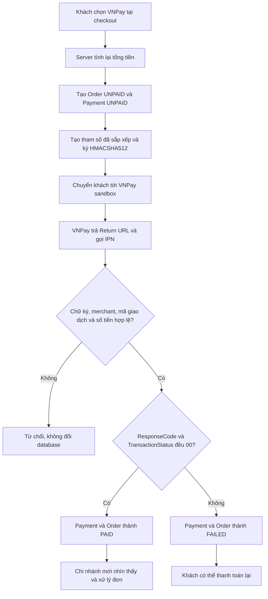

# Day 9 - Thanh toán VNPay sandbox

## 1. Chức năng

| URL | Chức năng |
|---|---|
| `POST /checkout` | Khách chọn COD hoặc VNPay; VNPay tạo đơn, giao dịch và chuyển tới cổng sandbox |
| `GET /payments/vnpay/return` | Nhận kết quả trình duyệt, kiểm tra chữ ký và hiển thị kết quả |
| `GET /payments/vnpay/ipn` | Nhận thông báo server-to-server, cập nhật giao dịch và trả JSON theo chuẩn VNPay |
| `POST /payments/vnpay/{code}/retry` | Chủ đơn tạo một lần thanh toán mới khi giao dịch cũ thất bại/chưa thanh toán |
| `GET/POST /contact` | Khách xem thông tin liên hệ và gửi đánh giá website, thức uống hoặc phục vụ |
| `GET /admin/feedback` | ADMIN xem danh sách phản hồi mới nhất |
| `GET /menu` | Hiển thị danh mục thức uống bằng tên và ảnh sản phẩm đại diện |

Tích hợp dùng VNPay API `2.1.0`, URL sandbox `https://sandbox.vnpayment.vn/paymentv2/vpcpay.html` và chữ ký `HMACSHA512`. Số tiền gửi đi được nhân 100 theo quy định VNPay.

Tài liệu chính thức:

- [Hướng dẫn tích hợp PAY](https://sandbox.vnpayment.vn/apis/docs/thanh-toan-pay/pay.html)
- [Chuyển đổi API 2.1.0 và HMACSHA512](https://sandbox.vnpayment.vn/apis/docs/chuyen-doi-thuat-toan/changeTypeHash.html)
- [Câu hỏi thường gặp về Return URL và IPN](https://sandbox.vnpayment.vn/apis/docs/faqs/)

## 2. Cấu hình

Thêm vào `application-local.properties` và tuyệt đối không commit giá trị thật:

```properties
vnpay.tmn-code=MA_WEBSITE_SANDBOX
vnpay.hash-secret=CHUOI_BI_MAT_SANDBOX
vnpay.return-url=http://localhost:8080/payments/vnpay/return
```

Trong trang quản lý VNPay sandbox, IPN production phải là URL HTTPS công khai:

```text
https://ten-mien-cua-ban/payments/vnpay/ipn
```

`localhost` chỉ nhận được Return URL qua trình duyệt, VNPay không thể gọi IPN vào máy cá nhân. Vì vậy Return URL cũng xử lý an toàn và idempotent để dự án có thể demo local; khi triển khai thật, IPN vẫn là kênh xác nhận chính.

## 3. Luồng thanh toán



## 4. Quy tắc an toàn

- `vnp_TxnRef` duy nhất cho từng lần thử thanh toán, không dùng trực tiếp mã đơn làm mã giao dịch.
- Callback phải kiểm tra chữ ký trước khi đọc và cập nhật giao dịch.
- Kiểm tra đúng `vnp_TmnCode`, số tiền đã nhân 100 và mã tham chiếu đã lưu.
- Callback dùng pessimistic lock; callback lặp lại chỉ trả `Order already confirmed`, không cập nhật lần hai.
- Chỉ khi cả `vnp_ResponseCode` và `vnp_TransactionStatus` bằng `00` mới đánh dấu `PAID`.
- STAFF không nhìn thấy và không xử lý đơn VNPay chưa thanh toán; ADMIN vẫn xem được để hỗ trợ khách nhưng không thể chuyển trạng thái.
- Đơn VNPay đang chờ hoặc đã thanh toán không cho khách tự hủy để tránh callback đến sau khi hủy và vì dự án chưa có nghiệp vụ hoàn tiền; giao dịch đã xác nhận thất bại mới có thể hủy.
- Chỉ chủ đơn mới tạo được lần thanh toán lại.

## 5. Phản hồi IPN

| Tình huống | `RspCode` |
|---|---|
| Cập nhật thành công | `00` |
| Không tìm thấy giao dịch | `01` |
| Giao dịch đã xử lý | `02` |
| Số tiền không khớp | `04` |
| Chữ ký không hợp lệ | `97` |
| Thiếu/sai dữ liệu | `99` |

## 6. Phân công (Day 9)

| Người | Phần việc | File chính |
|---|---|---|
| LamNhatAn | Cấu hình, ký URL, callback/IPN, transaction, kiểm tra số tiền/chữ ký, thanh toán lại; backend góp ý và truy vấn ảnh đại diện danh mục; phân quyền và unit test | `VnpayProperties`, `VnpayGateway`, `VnpayPaymentService`, `FeedbackService`, repository/controller và test |
| Nguyễn Tiến Đạt | Giao diện thanh toán/kết quả, badge trạng thái, trang liên hệ, danh mục menu dạng ảnh, footer liên hệ và tài liệu | `checkout.jsp`, `payment-result.jsp`, `contact.jsp`, `menu.jsp`, các JSP đơn hàng, CSS, `README.md`, `docs/*` |

## 7. Kiểm tra từng bước

1. Điền đúng `vnpay.tmn-code` và `vnpay.hash-secret` vào `application-local.properties`.
2. Chạy `mvnw.cmd clean test`: phải có **88 test** thành công.
3. Đăng nhập USER, thêm món vào giỏ và mở `/checkout`: thấy hai lựa chọn COD và VNPay.
4. Chọn VNPay, đặt hàng: trình duyệt chuyển sang tên miền `sandbox.vnpayment.vn`.
5. Thanh toán thành công bằng dữ liệu test do VNPay cung cấp: quay lại trang kết quả thành công; đơn có badge `Đã thanh toán`.
6. Đăng nhập STAFF đúng chi nhánh: đơn đã thanh toán xuất hiện và xử lý được.
7. Thử hủy/thoát thanh toán: đơn hiện `Thanh toán thất bại` hoặc `Chưa thanh toán`, có nút **Thanh toán lại qua VNPay**.
8. Trước khi thanh toán thành công, STAFF không thấy đơn và ADMIN không thể chuyển trạng thái đơn.
9. Gửi lại cùng callback: trạng thái không thay đổi lần hai.
10. Sửa số tiền hoặc chữ ký callback: hệ thống từ chối và database không đổi.
11. Mở `/menu`: thấy 4 thẻ danh mục có tên và ảnh sản phẩm đại diện; chọn một thẻ thì danh sách được lọc đúng loại.
12. Mở `/contact`, gửi phản hồi hợp lệ; đăng nhập ADMIN và kiểm tra phản hồi xuất hiện tại `/admin/feedback`.

## 8. Chuẩn bị Day 10

Day 10 làm thông báo realtime bằng WebSocket:

1. Cấu hình STOMP/WebSocket và xác thực kết nối bằng JWT hiện tại.
2. STAFF nhận thông báo đơn COD mới hoặc đơn VNPay vừa thanh toán của đúng chi nhánh.
3. Khách nhận thay đổi trạng thái của đơn mình mà không cần tải lại trang.
4. Thêm số lượng thông báo chưa đọc và xử lý reconnect.
5. Viết test phân quyền topic, đúng chi nhánh/đúng người dùng và tránh gửi trùng.
