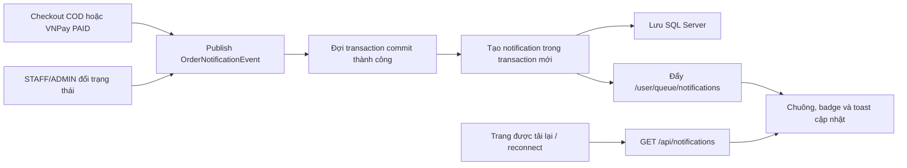

# Day 10 - Thông báo đơn hàng realtime

## 1. Chức năng

| Thành phần | Chức năng |
|---|---|
| `GET /api/notifications` | Trả tối đa 20 thông báo mới nhất và tổng số chưa đọc của user hiện tại |
| `POST /api/notifications/{id}/read` | Đánh dấu một thông báo thuộc đúng user hiện tại là đã đọc |
| `POST /api/notifications/read-all` | Đánh dấu toàn bộ thông báo của user hiện tại là đã đọc |
| WebSocket `/ws` | Kết nối STOMP cùng tên miền, xác thực bằng JWT cookie hiện tại |
| `/user/queue/notifications` | Hàng đợi riêng của từng tài khoản để nhận thông báo realtime |

- STAFF nhận thông báo khi có đơn COD mới của đúng chi nhánh.
- Đơn VNPay chỉ thông báo cho STAFF sau khi callback hợp lệ xác nhận đã thanh toán.
- Khách hàng chỉ nhận hai thông báo cần thiết: cửa hàng đã nhận và đang chuẩn bị đơn; đơn đã giao tới nơi. Các bước trung gian không làm phiền khách.
- Chuông thông báo, số chưa đọc, danh sách 20 thông báo và toast realtime có trên layout khách, nhân viên và quản trị.
- Thông báo được lưu trong SQL Server nên tải lại trang hoặc mất kết nối vẫn không mất; JavaScript tự kết nối lại sau 5 giây.
- Quầy STAFF tách thành `Đơn mới cần nhận` và `Đang pha chế / giao`, không trộn đơn cũ với đơn mới.
- Nút nhận đơn chuyển thẳng từ `PENDING` sang `PREPARING`; lịch sử vẫn ghi đủ bước xác nhận và bắt đầu pha chế. Trang xử lý tiếp tục chuyển `PREPARING → DELIVERING → COMPLETED` mà không hiện hộp xác nhận của trình duyệt.
- Mỗi đơn hiển thị đầy đủ món, tùy chọn, ghi chú, số điện thoại, email, địa chỉ cùng nút gọi, SMS và email để STAFF liên hệ khi có vấn đề.
- STAFF có trang `Tình trạng món`: đánh dấu món tạm hết hoặc mở bán lại. Món tạm hết vẫn xuất hiện trên menu với nhãn `Đã hết`, nhưng không thể thêm vào giỏ hoặc thanh toán.
- Chỉ sản phẩm thuộc danh mục `Trà sữa` được chọn topping. Các loại thức uống khác không hiển thị topping; backend kiểm tra lại khi thêm giỏ và thanh toán để chặn dữ liệu gửi giả hoặc giỏ hàng cũ không hợp lệ.

## 2. Luồng xử lý



Event chỉ được xử lý ở pha `AFTER_COMMIT`, vì vậy database lỗi hoặc transaction rollback sẽ không gửi thông báo giả.

## 3. Phân quyền và chống trùng

- HTTP handshake `/ws` phải có JWT cookie hợp lệ; khách chưa đăng nhập không kết nối được.
- Channel interceptor chỉ cho subscribe đúng `/user/queue/notifications`; client không được subscribe topic chi nhánh hoặc hàng đợi tùy ý.
- `convertAndSendToUser` gửi theo email đăng nhập nên mỗi kết nối chỉ nhận hàng đợi riêng.
- STAFF được truy vấn theo đồng thời `role=STAFF`, `active=true` và `branch_id` của đơn.
- API đọc/đánh dấu đã đọc luôn truy vấn kèm `userId`, không nhận chủ sở hữu từ client.
- Unique constraint `(user_id, event_key)` ngăn callback VNPay hoặc event đồng thời tạo thông báo lặp.

## 4. Database

Máy đã có dữ liệu cũ chạy một lần:

```powershell
sqlcmd -S localhost -E -C -f 65001 -i database\day10-add-notifications.sql
```

Máy tạo database mới bằng `database/schema.sql` không cần chạy migration riêng.

## 5. Phân công Day 10

| Người | Phần việc | File chính |
|---|---|---|
| LamNhatAn | WebSocket/STOMP, event sau commit, lưu và phân quyền thông báo, chống trùng, tích hợp checkout/VNPay, luồng nhận–pha chế–giao, controller quầy đơn, migration và unit test | `WebSocketConfig`, `Notification*`, `OrderNotification*`, `StaffOrderController`, các order service và test |
| Nguyễn Tiến Đạt | Chuông thông báo, badge chưa đọc, dropdown, toast realtime, reconnect, hai giao diện đơn mới và đơn đang xử lý, thông tin liên hệ khách, tích hợp layout và tài liệu | `notification-center.jspf`, `notifications.js`, `staff/orders/*`, decorator, `app.css`, `README.md`, `docs/*` |

## 6. Kiểm tra

1. Chạy `mvnw.cmd clean test`: phải có **117 test** thành công.
2. Mở hai trình duyệt hoặc một cửa sổ thường và một cửa sổ ẩn danh.
3. Cửa sổ thứ nhất đăng nhập `staff3@utetra.vn`; cửa sổ thứ hai đăng nhập USER.
4. USER đặt đơn COD tại chi nhánh Gò Vấp: `staff3` nhận toast và badge tăng ngay, không tải lại trang.
5. Đăng nhập `staff1`: không được nhận thông báo của đơn Gò Vấp.
6. Trang `Đơn mới cần nhận` chỉ có đơn `PENDING`, xếp đơn cũ trước; kiểm tra món, ghi chú và các nút liên hệ khách.
7. Nhấn `Nhận đơn & bắt đầu pha chế`: đơn biến mất khỏi trang đơn mới và xuất hiện ở trang `Đang pha chế / giao` với trạng thái `PREPARING`.
8. Nhấn `Pha chế xong · bắt đầu giao`, sau đó `Đã giao · hoàn thành đơn`; đơn phải rời đúng khu vực sau mỗi bước và không xuất hiện hộp xác nhận.
9. USER chỉ nhận thông báo khi đơn chuyển sang `PREPARING` và `COMPLETED`; nội dung thân thiện, có mã đơn và link xem chi tiết.
10. Tắt mạng vài giây rồi bật lại: WebSocket tự kết nối lại ngầm; thông báo lưu trong database vẫn xuất hiện.
11. Nhấn “Đánh dấu đã đọc”: badge về 0 và không ảnh hưởng thông báo của tài khoản khác.
12. Với VNPay, trước khi thanh toán thành công STAFF không nhận thông báo; sau callback thành công chỉ nhận đúng một lần.

## 7. Chuẩn bị Day 11

Day 11 làm **chat hỗ trợ khách hàng theo chi nhánh**:

1. USER chọn chi nhánh và mở một cuộc trò chuyện hỗ trợ.
2. STAFF chỉ xem và trả lời hội thoại của chi nhánh mình; ADMIN có thể xem toàn hệ thống.
3. Tin nhắn gửi/nhận realtime qua hàng đợi riêng, đồng thời lưu `chat_messages` để tải lại không mất lịch sử.
4. Có số tin nhắn chưa đọc, đánh dấu đã đọc, trạng thái `OPEN/CLOSED` và ngăn gửi vào hội thoại đã đóng.
5. Kiểm tra quyền sở hữu hội thoại, giới hạn chi nhánh, nội dung rỗng/quá dài, reconnect và chống gửi trùng.
